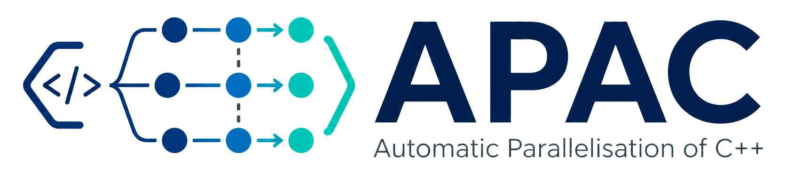

<div align="center">
  

  **Automatic Parallelisation of C++ using OpenMP task dependencies**

  Source-to-source compiler built on LLVM/Clang 18

  [](LICENSE)
  [](https://isocpp.org/)
  [](https://llvm.org/)
  [](https://www.openmp.org/)
  [](https://ghcr.io/berenger-eu/apac)

</div>

---

## Overview

**APAC** is a source-to-source compiler that automatically transforms sequential C++ programs into parallel code using OpenMP task dependencies.

Given a plain C++ source file, APAC analyses data dependencies between statements and rewrites the source with `#pragma omp task depend(...)` directives so that the output can exploit multiple processor cores without requiring manual annotations.

Array and pointer dependency conventions are described in [Array dependencies and phases](docs/array-phases.md).

APAC is built on **LLVM/Clang 18** and implements its analysis as a pipeline of composable transformation passes.

---

## Statement of Need

Writing correct parallel code with OpenMP task dependencies requires identifying every data dependence between statements and annotating every task with correct `depend(in: ...)`, `depend(out: ...)`, or `depend(inout: ...)` clauses.

Missing or incorrect annotations can produce hard-to-reproduce data races.

APAC automates this annotation process for pointer-based and recursive C++ programs, targeting scientific computing codes that fall outside the affine loop model assumed by polyhedral compilers.

---

## Key Features

- **Fully automatic**  
  No source annotations are required on the input.

- **Source-to-source compilation**  
  The output is readable C++17 code with OpenMP directives.

- **OpenMP task dependencies**  
  APAC generates `#pragma omp task depend(...)` directives automatically.

- **Interprocedural analysis**  
  `ParamWriteAnalyzer` detects read-only pointer parameters across call trees, improving parallelism for divide-and-conquer codes.

- **Bounded recursion**  
  Recursion depth control prevents unbounded task creation.

- **Modular pipeline**  
  Transformation passes can be applied individually or as part of the full APAC pipeline.

---

## Installation

### Option 1 - Docker

Docker is the recommended installation method.
*(The pre-built image is automatically built and published on release. It contains APAC already compiled and all dependencies ready to use.)*

Pull the latest image:

```bash
docker pull ghcr.io/berenger-eu/apac:latest
```

Open shell in the container:

```bash
docker run --rm -v $(pwd):/workspace -it ghcr.io/berenger-eu/apac:latest /bin/bash
```

### Option 2 - Build the Docker image locally

```bash
docker build -t apac .
docker run --rm -v $(pwd):/workspace -it apac /bin/bash
```

### Option 3 - Local build

#### Requirements

* CMake ≥ 3.0
* LLVM 18 with development headers
* Clang 18
* GCC or Clang with C++17 support
* OpenMP-capable compiler

On Debian/Ubuntu, LLVM 18 can be installed with:

```bash
wget https://apt.llvm.org/llvm.sh
chmod +x llvm.sh
sudo ./llvm.sh 18 all
```

Build APAC:

```bash
mkdir -p build
cd build
cmake ..
make -j$(nproc)
```

Optionally enable Clang-Tidy static analysis:

```bash
cmake -DENABLE_CLANG_TIDY=ON ..
```

---

## Quickstart

### Minimal example

Given `example.cpp`:

```cpp
long sum(int *data, int start, int end) {
    if (end - start <= 1) return data[start];

    int mid = start + (end - start) / 2;
    long left  = sum(data, start, mid);
    long right = sum(data, mid, end);

    return left + right;
}

int main() {
    int *data = new int[1000];

    int mid = 500;
    long r1 = sum(data, 0, mid);
    long r2 = sum(data, mid, 1000);

    return (int)(r1 + r2);
}
```

Run APAC:

```bash
# After a local build
./build/apac example.cpp

# Or with Docker
docker run --rm -v $(pwd):/workspace ghcr.io/berenger-eu/apac:latest apac example.cpp
```

APAC generates:

```text
APACexample.cpp
```

This output file contains OpenMP task dependencies inserted automatically.

Compile and run the generated version:

```bash
g++ -O2 -fopenmp -o example_par APACexample.cpp
OMP_NUM_THREADS=4 ./example_par
```

---

### Individual transformation passes

Each pass can also be invoked directly.

Example with `TaskGraph`:

```bash
./build/taskGraph input.cpp [options] --
```

Available options:

| Option                   | Description                                             |
| ------------------------ | ------------------------------------------------------- |
| `-main <name>`           | Specify the entry-point function name. Default: `main`. |
| `-functions <f1,f2,...>` | Transform only the listed functions.                    |
| `-ignore <f1,f2,...>`    | Skip the listed functions.                              |

---

## Available Transformation Passes

The full APAC pipeline applies the main passes in order.

| Pass                   | Binary                 | Purpose                                                          |
| ---------------------- | ---------------------- | ---------------------------------------------------------------- |
| `DuplicateFunctions`   | `duplicateFunctions`   | Create sequential fallback copies with the `_apacSeq` suffix.    |
| `ConditionUnstack`     | `conditionUnstack`     | Extract declarations from `if` and `while` conditions.           |
| `MultipleDeclSplitter` | `multipleDeclSplitter` | Split multi-variable declaration lines.                          |
| `Unstack`              | `unstack`              | Extract eligible calls from nested expressions and returns.     |
| `DeclarationSplitter`  | `declarationSplitter`  | Separate declarations from initialisations.                      |
| `GotoTransfo`          | `gotoRet`              | Replace `return` statements with a single-exit `goto` structure. |
| `TaskGraph`            | `taskGraph`            | Insert OpenMP tasks and dependency pragmas.                      |
| `MainParallel`         | `mainParallel`         | Wrap `main` in an OpenMP parallel region.                        |
| `ApacDepth`            | `apacDepth`            | Add recursion depth control to bound task creation.              |

`Unstack` runs before declaration splitting and return lowering. For example,
`return f(x) + g(x);` becomes two temporary initializations followed by the
addition, allowing TaskGraph to schedule the calls independently. Scalar
prvalues retain their value category at use sites. Reference-returning calls
stay inside their consumers, avoiding reference_wrapper lowering of generated
reference temporaries. Control headers and lazy/unevaluated operands are kept intact.
Class prvalues, overloaded operators, volatile accesses and expressions requiring
cleanup remain full expressions, preserving copy elision and destruction timing.
Argument lists with residual reads are kept together to avoid interleaving
argument evaluations. Self-referential initializers, switch bodies and functions
with existing gotos are retained to preserve declaration scope and legal jumps. Sequential fallback copies are never rewritten.

Additional available passes:

* `constify`
* `stackheap`

---

## Input / Output Expectations

### Input

APAC accepts plain C++ input files. No OpenMP annotations are required.
All stages of the APAC pipeline enable OpenMP parsing, so an existing explicit
`#pragma omp taskwait` is retained when functions are duplicated or rewritten,
even without adding `-fopenmp` to APAC's input flags. `_OPENMP` is consequently
defined consistently throughout the pipeline.

The complete `apac` pipeline automatically applies the normalisation passes required by later analyses, including declaration splitting and multiple declaration splitting.

### Output

The transformed file is placed alongside the input file with an `APAC` prefix.

Example:

```text
foo.cpp      -> APACfoo.cpp
example.cpp  -> APACexample.cpp
```

The generated file contains OpenMP task pragmas and must be compiled with OpenMP support.

Example:

```bash
g++ -O2 -fopenmp -o output APACfoo.cpp
```

---

## Testing

**With Docker:**

```bash
docker run --rm -v $(pwd):/workspace ghcr.io/berenger-eu/apac:latest bash scripts/run-tests.sh
```

**After a local build:**

```bash
mkdir -p build && cd build
cmake -DLLVM_DIR=/usr/lib/llvm-18/cmake ..
make -j$(nproc)
cd ..
bash scripts/run-tests.sh
```

DeclarationSplitter and TaskGraph snapshots check tool exit codes, normalized
source, and compiler ASTs. TaskGraph also compiles every snapshot with OpenMP
enabled and requires both DOT graphs. Failed diagnostics are retained under
`transforms/<Transformation>/tests/results/`; these two suites have no exclusions.
The global runner additionally checks transformed programs at `-O0` and `-O2`
with 1, 2, and 4 OpenMP threads, and verifies that broken tools, invalid C++, and
missing graphs cannot produce successful snapshot tests.

TaskGraph preserves loops (`for`, `while`, `do`, range-for) as synchronous
statements after waiting for earlier tasks. Tasks resume after loops proven to
preserve aliases: currently scalar operations and direct calls whose visible
bodies also satisfy this restriction. Pointer/reference/object operations, inline
assembly, TLS/attributed variables and calls without visible bodies retain a
sequential function tail.
Fusion cannot move tasks across a synchronization boundary, including one nested
in an `if`. Parallelizing loop bodies still requires loop-carried dependency analysis.
Explicit accesses to globals contribute ordinary read/write dependencies, just
like accesses to locals. Pointers, references and global arguments use the same
alias/parameter analysis as local storage. Calls do not inherit dependencies for
globals accessed inside their callees, including transitive calls. Dependencies
therefore do not provide a global execution order across unrelated task contexts.
The program must protect shared accesses where needed (mutexes, atomics, etc.);
APAC does not insert these protections automatically. Values copied from a global
into a local retain the normal dependencies on that local.

Individual transformation test suites can also be run directly, for example:

```bash
cd transforms/TaskGraph/tests
bash test.sh
```

---

## Optional static task cost

Enable the coarse work model while transforming a source file:

```bash
build/apac input.cpp --static-cost -- -std=c++17
APAC_COST_THRESHOLD=1000 OMP_NUM_THREADS=8 ./program
```

The threshold is a score in abstract work units, not a time in nanoseconds.
Without `--static-cost`, generated code keeps its existing behavior. With the
option, an unset or zero threshold disables the cost cutoff. A positive threshold
selects the sequential clone when the estimated work is below the threshold;
the depth cutoff still applies independently.

The model adds operations and callee costs and multiplies loop bodies by an
estimated iteration count. Recursive paths use `max(1,n) * local_work(n)`; terminal paths keep their local
work without the recursive multiplier. The selected branch controls whether a
recursive edge is reached (unknown branches remain conservative).
For a mutually recursive group, APAC removes internal calls from the cost graph,
sums each member's local work once and multiplies by `max(1,n)`. For example,
`f1 -> f2 -> f1` produces `n * (local_f1 + local_f2)`, with no recursive calls
between estimators. Quicksort remains roughly quadratic in this heuristic.
For self-recursion with at least two call sites of the form `f(n-k)` (positive
constant decrements up to 63, at most 16 sites and no recursive calls in loops),
APAC instead estimates the branching tree with a bounded dynamic program.
For `f(n-1) + f(n-2)`, this keeps Fibonacci's exponential growth in the score.
The table has at most 128 entries and saturates; it never executes application
code or recursively calls another estimator. Terminal paths remain unscaled.
Other recursions retain the simple size multiplier.

Currently `n` is a by-value integer parameter: a parameter named `n`, `size`,
`count` or `bodies` is preferred, otherwise the first eligible integer is used.
The model supports global free functions and does not inspect pointed-to data or
container contents. Unsupported expressions, external calls and exhausted model
budgets yield an unknown score, which preserves tasking. Arithmetic saturates
rather than wrapping. The model is a granularity heuristic, not a complexity
proof; its evaluation is bounded to 64 local model evaluations per estimate.

At function entry the cutoff selects the sequential clone and suppresses its
child tasks. A caller may already have created that function's task. In supported
call loops, a runtime branch creates a task only for a sufficiently large call.
The small-call branch first waits for prior child tasks, then calls the sequential
clone directly, with a scoped guard keeping transitive calls sequential too.
It creates no call task or dependency descriptor. This conservative wait can
serialize independent pending calls. Outside these supported loops, function
entry still chooses the sequential clone after the caller's task has started;
that boundary task remains, but its descendants are suppressed.

## Benchmarks

Six kernels run by default: Fibonacci, quicksort, merge sort, blocked matrix
multiplication, N-body and Jacobi. N-Queens is an additional sequential control
case. Every sample verifies its result outside the measured interval.

```bash
python3 benchmarks/benchmark.py prepare --build-dir build --output-dir /tmp/apac-benchmarks
```

Transfer the prepared directory to a compute node, then compile and run there:

```bash
cd /path/to/apac-benchmarks
python3 run.py run --output-dir . --profile standard --threads 1 2 4 8 --repeat 7
```

Only Python 3 and GCC/OpenMP are needed on the compute node. The runner compares
the sequential original and three APAC variants (unlimited, default depth, static
cost), each with one and multiple threads. `--cost-threshold` sets the cost
cutoffs (defaults: 100000, 1000000, 100000000, 1000000000). It exports raw CSV samples and a JSON report with machine/build metadata.
See [the benchmark guide](benchmarks/README.md) for granularity, input profiles,
validation and timing details.

---

## How to Cite

If you use APAC in your research, please cite the latest APAC paper:

> Julien Gaupp, Bérenger Bramas.
> *Contraintes d'OpenMP pour la parallélisation automatique à base de tâches.*
> COMPAS 2025, Bordeaux, France.
> [hal-05293644](https://inria.hal.science/hal-05293644)

For the initial presentation of the project, see also:

> Garip Kusoglu, Bérenger Bramas, Stéphane Genaud.
> *Automatic task-based parallelization of C++ applications by source-to-source transformations.*
> Compas 2020, Lyon, France.
> [hal-02867413](https://inria.hal.science/hal-02867413)

Machine-readable citation metadata is available in [`CITATION.cff`](CITATION.cff).

---

## Contributing

See [`CONTRIBUTING.md`](CONTRIBUTING.md) for:

* development setup;
* coding standards;
* test commands;
* bug reports;
* feature proposals.

---

## Support

For support, see [`SUPPORT.md`](SUPPORT.md) or open an issue.

---

## License

APAC is distributed under the [MIT License](LICENSE).
Copyright © 2023–2026 Julien Gaupp, Bérenger Bramas, Kylian Gerard, Université de Strasbourg / Inria.
